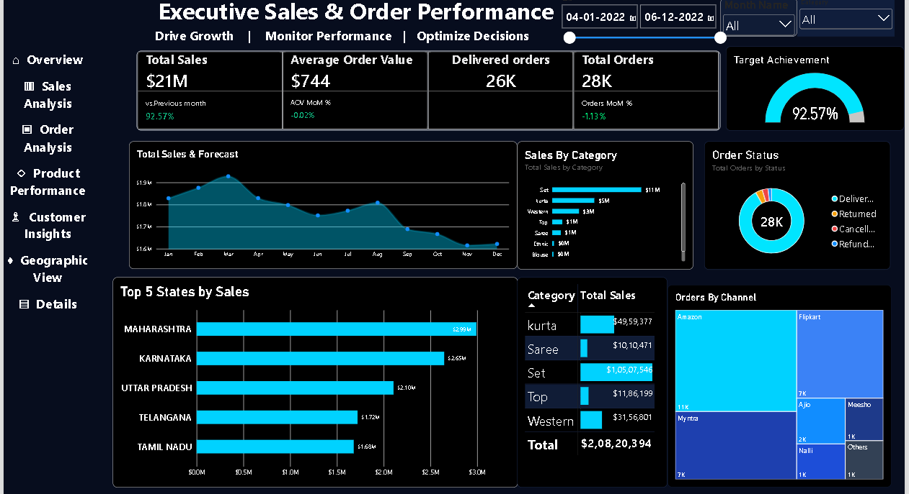

# 📊 Executive Sales & Order Performance Dashboard (Power BI)

## 🚀 Project Overview
Yeh Power BI executive dashboard e-commerce sales performance, regional trends, product categories aur sales channels ko deeply analyze karne ke liye design kiya gaya hai. Iska main objective business growth ko track karna, performance monitor karna aur sahi business decisions lene mein madad karna hai.

## 🛠️ Tools & Technologies Used
* **Power BI Desktop:** Interactive dashboards, data modeling aur visual storytelling ke liye.
* **Advanced Excel / Power Query:** Raw data cleaning aur transformation ke liye.

## 📌 Key Performance Indicators (KPIs)
* **Total Sales:** $21M
* **Average Order Value (AOV):** $744
* **Total Orders:** 28K *(Delivered Orders: 26K)*
* **Target Achievement:** 9257%

## 📈 Dashboard Sections & Key Visuals
1. **Total Sales & Forecast:** Monthly sales ka trend aur performance tracking.
2. **Sales By Category:** Alag-alag product categories ki total sales distribution.
3. **Order Status:** Delivered, Returned, Cancelled, aur Refunded orders ka complete breakdown.
4. **Top 5 States by Sales:** Maharashtra, Karnataka, Uttar Pradesh, Telangana, aur Tamil Nadu top revenue-generating states hain.
5. **Orders By Channel:** Amazon, Flipkart, Myntra, Ajio, Meesho, aur Nalli jaise platforms par sales ka contribution.

## 🖼️ Dashboard Screenshots

## 💡 Key Business Insights
* **Maharashtra aur Karnataka** top performing regions hain jahan se sabse zyada revenue generate hua hai.
* **Amazon, Myntra aur Flipkart** sabse bade sales channels ke roop mein ubhar kar aaye hain.
* Product categories mein **Set** aur **Kurta** ki demand sabse high hai.
